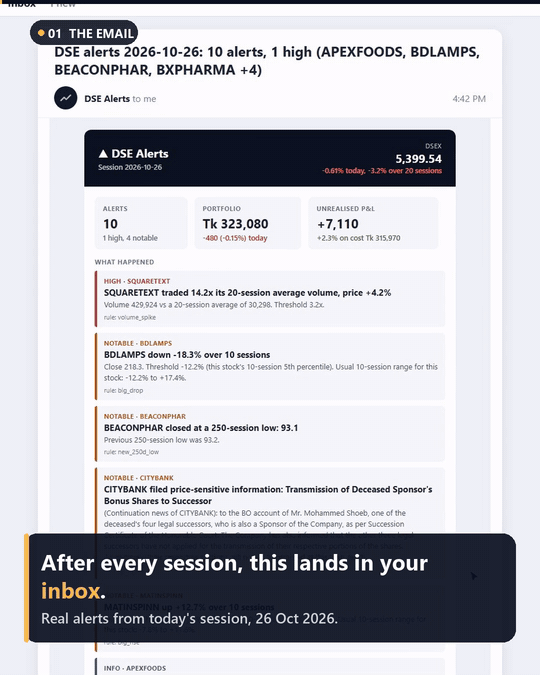
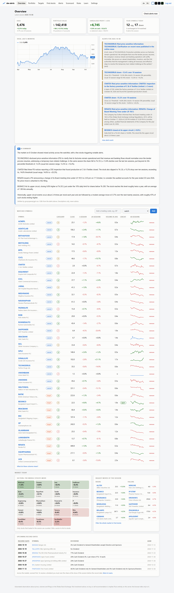
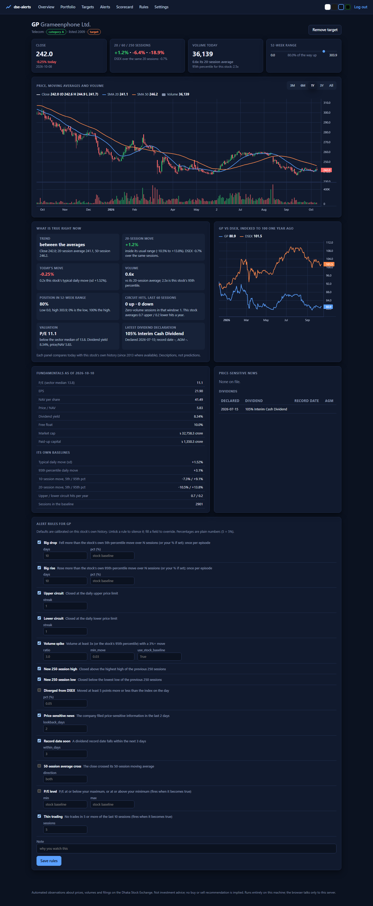
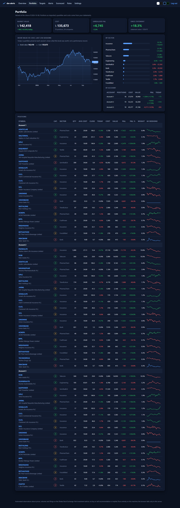
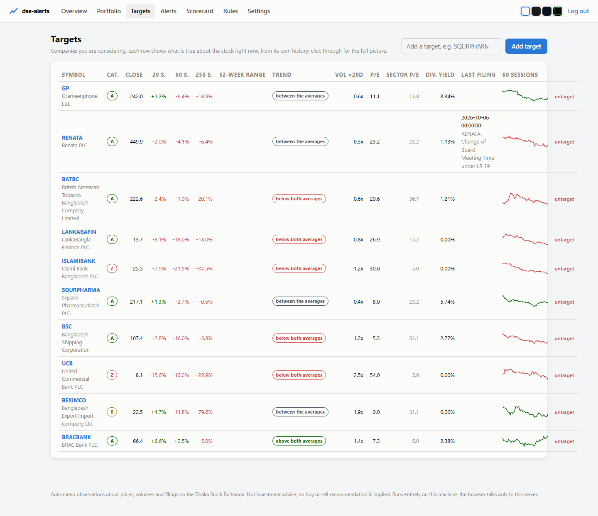
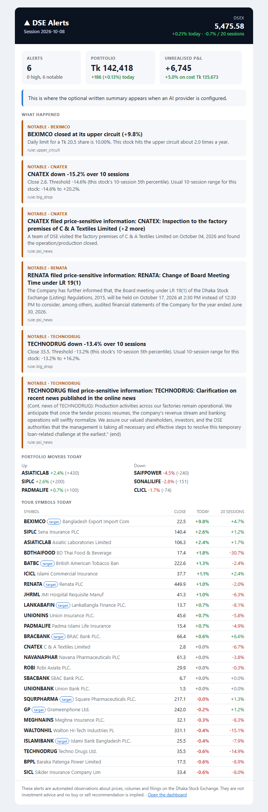
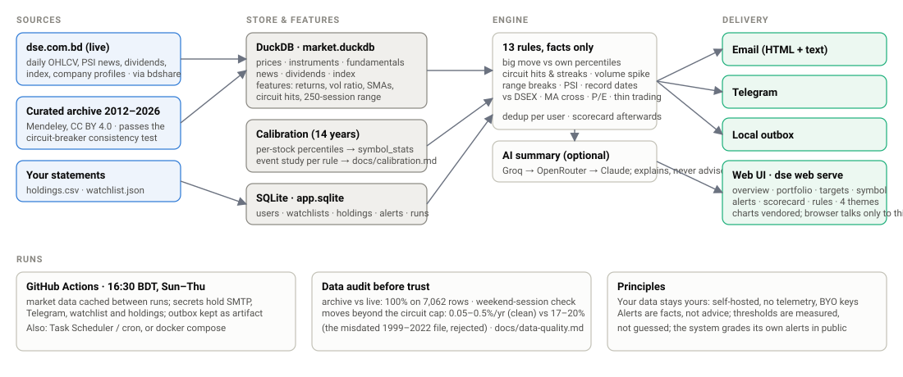

# dse-alerts

**Self-hosted stock alerts and a personal analytics desk for the Dhaka Stock Exchange.**
Add the companies you hold or are considering, pick the conditions you care about, and get
an email (and a Telegram message, if you set up a bot) after each session when something happened. Rules are
tuned to how the DSE actually behaves (circuit-breaker slabs, A/B/Z categories, price-sensitive
filings, record dates) and calibrated on 13 years of daily data (2013 to 2026), so an alert means something
instead of firing every other day. The web UI shows what is true about each stock right now,
values your portfolio, and grades the alerts it sent you.

> **Facts to decide with, not tips.** It tells you what happened, how unusual that is for
> that stock, and what the record says about such events, so you can decide what to buy,
> hold or sell with the facts in one place.

**Try it:** a hosted demo lives at <https://dsealerts-bd.indiasouthcentral.cloudapp.azure.com>; press
*Try the demo* on the home page for a read-only tour, or create an account in ten seconds.
Hosting your own public copy takes one setup script: [docs/hosting.md](docs/hosting.md).

**বাংলা:** the whole thing, pages, emails, Telegram and the AI note, works in Bangla as
well as English. Switch with the EN / বাং toggle in the header; the choice is saved per user.



*The email after a session: real alerts from 26 Oct 2026. [Full walkthrough and overview page below.](#screens)*

## What you get

| | |
|---|---|
| **Alerts** | 13 DSE-specific rules; each one states a fact about the latest session and carries the numbers behind it. Delivered by **email** (HTML, with your portfolio snapshot) and **Telegram**, and kept in a local outbox. |
| **Calibrated thresholds** | "Big" means big *for that stock*: thresholds come from each company's own history (977k sessions, 2013 to 2026), not from a fixed percentage. The 9 price rules are backtested and the numbers are published. |
| **Portfolio** | Add holdings by hand or upload them with the CSV template; see market value, cost, unrealised P&L, the day's move, value history, allocation by sector, and every position with a 60-session sparkline. Several accounts are fine. |
| **Targets** | Companies you are considering, side by side: 20/60/250-session moves, position in the 52-week range, trend vs moving averages, volume, P/E against the sector median, last filing. |
| **Market today** | On the overview: a sector board coloured by the session's moves, the biggest risers and fallers, and upcoming dividend record dates for your symbols. |
| **Find stocks** | A simple screener over every stock that traded: sector, category, P/E, 20-session move, volume vs average, distance from the 52-week low or high, with one-click presets. |
| **Learn** | A plain-language page for first-time investors: sessions, circuit breakers, categories, percentiles, P/E, record dates, and what every column and rule means. Every column heading also explains itself on hover. |
| **Symbol page** | Candlesticks with SMA 20/50 and volume, the stock vs DSEX indexed to 100, "what is true right now" panels, fundamentals, filings, dividends, and the rule switches for that stock. |
| **Scorecard** | What happened 5 and 20 sessions after each alert you were sent, next to the backtest's expectation. It grades the rules, not you. |
| **AI summary (optional)** | A short written note per session from Groq, OpenRouter or Claude, in that order of preference, shown on the overview and included in the email. Told never to advise. Off unless you add a key. |
| **Two languages** | English and Bangla, for every page, every alert, the email, Telegram, the Learn page and the AI note. One toggle in the header. |
| **Four themes** | Light, dark, midnight, terminal. Charts follow the theme. |
| **Demo mode** | For a public instance: a shared read-only account with a sample list and portfolio, so visitors can look around without signing up. |

## Principles

* **Your data stays yours.** Everything runs on your machine, your own server or your own
  GitHub account. No telemetry, no accounts anywhere, no third party sees your holdings.
  Market data is fetched by you, from DSE, into a local DuckDB file. The browser talks only
  to this server; the chart library is vendored. The one exception is opt-in: with the AI
  note on, the alert text (codes, prices, percentages) goes to the provider that writes it.
* **Comparable prices.** Returns, ranges, moving averages and thresholds are computed on
  prices adjusted for bonus shares and rights issues (the archive's adjusted series, extended
  with declared stock dividends after it ends). Sessions without a price limit, the day after
  a record date and "Price Limit Open" days, are never counted as circuit hits, and a move
  beyond the limit that nothing explains raises no alert at all.
* **Alerts are facts, not advice.** "BEXIMCO closed at its upper circuit, 2.0 times a year
  for this stock" is an alert. "Buy BEXIMCO" is not, and the tool never says it.
* **Measured, not guessed.** The data was audited before it was trusted, the thresholds come
  from the history, every price rule has a backtest, and the system scores its own alerts.
* **Optional extras stay optional.** Email needs an SMTP login; Telegram a bot token; the
  AI summary an API key. Without any of them, alerts still run and land in `data/outbox/`.
* **Safe to leave on the internet.** Passwords are argon2id hashes; sessions are signed,
  HttpOnly, Secure cookies that a password change invalidates; every form carries a CSRF
  token; login and sign-up are rate limited; every response carries a Content Security
  Policy and the usual hardening headers; the container runs unprivileged. Alerts are only
  ever emailed or sent on Telegram to a destination the user has confirmed, so nobody can
  point the operator's mail account or bot at a stranger.

## Screens



| Symbol page | Portfolio |
|---|---|
|  |  |

| Targets | Email |
|---|---|
|  |  |

More in [docs/screens](docs/screens).

## Architecture



| Layer | Stack |
|---|---|
| Data | dse.com.bd through bdshare (live), Mendeley DSE archive from Oct 2012 (audited before use) |
| Storage | DuckDB for market data and features, a read-only snapshot for the website, SQLite for users, holdings and alerts |
| Analysis | pandas and DuckDB SQL; per-stock percentiles and a backtest on 2013 to 2026 |
| Engine | 13 rule-based alerts with the evidence attached, a scorecard, an optional AI note that is fact-checked |
| Delivery | Email over SMTP (HTML and text), Telegram Bot API, a local outbox |
| Web | FastAPI, Jinja2, plain JavaScript, lightweight-charts; English and Bangla; argon2 and signed cookies |
| Hosting | Docker Compose (web, scheduler, Caddy for HTTPS) on any VM, or GitHub Actions with no server |
| Quality | pytest (98 tests), ruff, Playwright layout checks |

**Every trading day at 16:30 Dhaka time** (Sunday to Thursday) the scheduler pulls the
session's prices, news and dividends, stops if DSE has not published yet, rebuilds the
features, runs the alerts and sends them, then publishes a fresh snapshot for the website.
A failed or late step is retried every 30 minutes until 21:30.

Full stack, the daily chain step by step, and the design decisions behind them:
[docs/architecture.md](docs/architecture.md).

## Quick start

```bash
git clone https://github.com/ZubayerOjhor/dse-alerts && cd dse-alerts
python -m venv .venv && .venv\Scripts\activate        # Windows; on Linux/macOS: source .venv/bin/activate
pip install -e ".[web,ai]"
copy .env.example .env                                  # fill in what you use; blank is fine

dse data bootstrap          # archive (auto-download; see below for the better one)
dse data refresh            # everything newer from dse.com.bd: prices, news, dividends, index
dse data instruments        # company profiles, categories, sectors, fundamentals (~2 min)
dse analysis features       # per-session features
dse analysis import-stats   # per-stock baselines (committed), or `dse analysis calibrate` to recompute

dse alerts init --email you@example.com
dse alerts add GP SQURPHARMA --email you@example.com
dse portfolio import data/holdings.csv --email you@example.com   # optional: account,symbol,quantity,avg_cost,...
dse alerts run --dry-run    # evaluate the latest session, print, change nothing
dse web serve               # http://127.0.0.1:8000
```

**History before 2024.** The DSE site only serves about a year of history. For everything
older, download the curated archive by hand (its files are not exposed to scripts):
[Mendeley 23553sm4tn](https://data.mendeley.com/datasets/23553sm4tn/4) > *Download All* >
extract under `data/raw/mendeley_23553sm4tn/`, then run `dse data bootstrap` again. Without
it, an automatically downloaded fallback archive supplies 2023 onward. Why only 2023, when
that file claims 25 years: its pre-2023 rows are misdated by months, which a circuit-breaker
consistency test exposed. The audit is in [docs/data-quality.md](docs/data-quality.md).

## Running it every day

[docs/deploy.md](docs/deploy.md) covers three ways:

* **GitHub Actions** (free, nothing to host): fork, add `SMTP_USER` and `SMTP_PASSWORD`
  secrets (a Gmail app password), optionally `TELEGRAM_BOT_TOKEN`, `TELEGRAM_CHAT_ID`,
  `WATCHLIST_JSON` and `HOLDINGS_CSV`. It runs at 16:30 Bangladesh time on trading days and
  caches market data between runs.
* **Your own machine**: Task Scheduler or cron running `dse data refresh && dse analysis features && dse alerts run`.
* **Docker**: `docker compose up -d` gives you the web UI and a scheduler.

To put one instance on the internet for other people to try, with the demo account and
open registration, see [docs/hosting.md](docs/hosting.md): free with the GitHub Student
Developer Pack on Azure ([step by step](docs/azure.md), no card, one setup script), free on
Oracle Cloud if its card check lets you in ([guide](docs/oracle-cloud.md)), Fly.io in five
commands, or any box with Docker.

## Languages

The UI, emails, Telegram messages and the AI note come in English and Bangla. The header
toggle sets a cookie for the browser; Settings saves the preference for the account, and
that is what the daily email uses. Translations live in two JSON files
(`dse_alerts/i18n/en.json`, `bn.json`); alert headlines are rebuilt in Bangla from the
numbers each rule stores, so past alerts translate too. Adding a language is one more file.

## The rules

| Rule | Default | Fires per stock-year | Median 20-session move after |
|---|---|---|---|
| `big_drop` / `big_rise` | beyond the stock's own 5th / 95th percentile 10-session move, once per episode | 4.1 / 3.4 | -0.3% / -2.1% |
| `upper_circuit` / `lower_circuit` | closed at the daily limit (streak configurable) | 2.4 / 0.7 | -0.7% / -2.6% |
| `volume_spike` | >= 3x (or the stock's 95th pct) with a 3%+ move | 7.0 | -1.6% |
| `new_250d_high` / `new_250d_low` | close beyond the previous 250 sessions' range | 2.1 / 3.7 | -1.0% / +1.0% |
| `psi_news`, `record_date` | filings and record dates from the exchange feed | | |
| `vs_index`, `ma_cross`, `pe_level` | opt-in: diverged 5 pts from DSEX, crossed the 50-session average, P/E level | | |
| `illiquid` | no trades in 5 of the last 10 sessions, when it begins | 0.8 | |

A fixed rule like "down 10% in 10 days" fires about 19 times a year *per stock* on the DSE;
the per-stock percentiles bring `big_drop` down to about 4 episodes a year that are unusual
for that company. Three sessions in a row at the lower circuit is rare (once in 50
stock-years) and is followed by a median -6% over the next 20 sessions; three in a row at
the upper circuit has a +21% *mean* but a +1% median, i.e. a few runaway pumps and many
fades. All of it, with the forward-return evidence per rule: [docs/calibration.md](docs/calibration.md).
The study's last table runs each rule exactly as it ships, with its default settings and once
per episode, and that is what the Rules page and the AI note quote; every "rose afterwards"
share sits next to the 44% of any session, so it can be read. Regenerate with
`dse analysis calibrate` and `dse alerts backtest`.

## Commands

```
dse data        bootstrap | refresh | instruments | validate | status
dse analysis    features | calibrate | export-stats | import-stats
dse alerts      rules | init | add | remove | list | import | run | backtest | scorecard
                test-email | test-telegram | telegram-id
dse portfolio   import | show | target
dse web         serve
dse demo        seed
```

## Repository map

```
dse_alerts/
  data/        archive loaders, live provider (bdshare), DuckDB store, ingestion flows
  analysis/    feature table, calibration study
  rules/       the 13 rules and their backtest predicates
  engine.py    evaluates rules per user and session; scorecard.py grades the outcomes
  portfolio.py holdings valuation and history; evidence.py "what is true right now"
  notify/      delivery context, text + HTML rendering, email, Telegram, outbox
  ai/          optional summary via Groq / OpenRouter / Anthropic
  i18n/        English and Bangla catalogs; alert headlines rebuilt per language
  web/         FastAPI app, templates (overview, portfolio, targets, find, learn, ...), vendored chart library, four themes, demo mode
calibration/   symbol_stats.csv, the per-stock baselines from the 14-year calibration
scripts/       scheduler.sh / start.sh for containers; screenshots.py
docs/          data-quality audit, calibration report, deployment and hosting guides, screenshots
tests/         64 tests (archive cleaning, store semantics, rules, engine, web, email, i18n, portfolio)
```

## Licence

MIT. Market data belongs to its sources (see [docs/data-quality.md](docs/data-quality.md));
the chart library is TradingView's lightweight-charts (Apache 2.0, vendored under
`dse_alerts/web/static/vendor/`). This tool is for information only and is not investment
advice.
